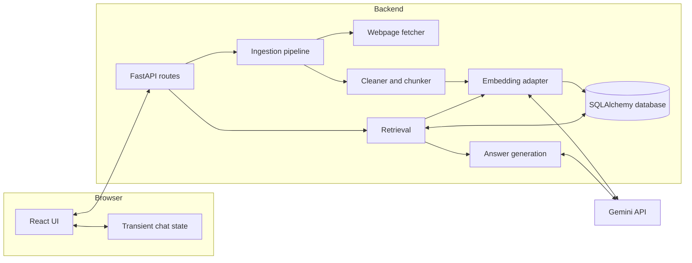
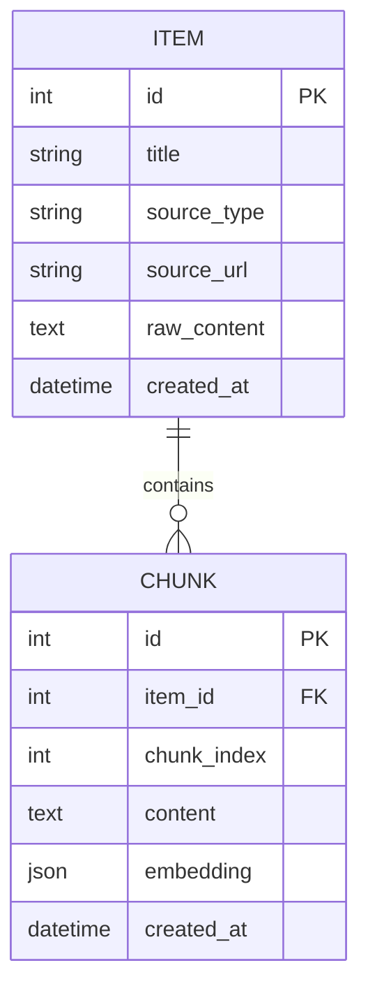
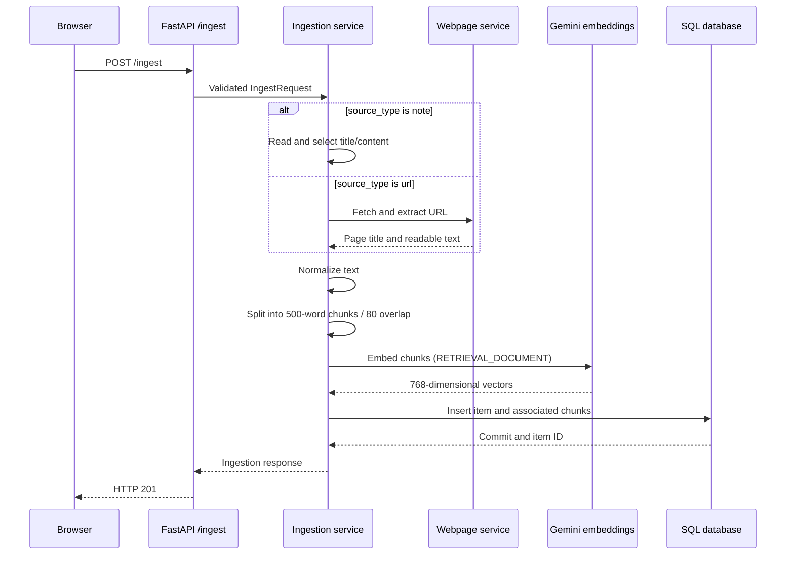
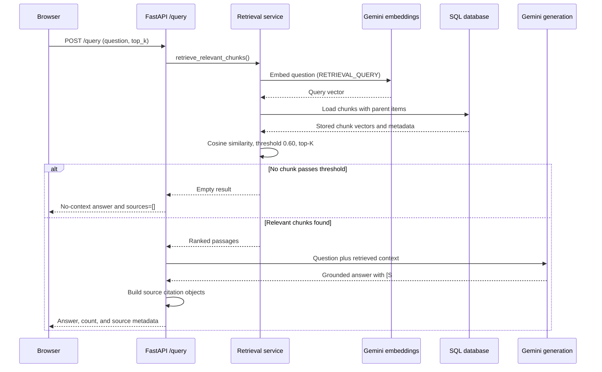

# Architecture

## 1. System overview

AI Knowledge Inbox is split into a React/Vite frontend and a FastAPI backend. The backend owns ingestion, persistence, semantic retrieval, and answer generation. Gemini is used for both embeddings and generated answers.

## 2. Backend components

| Component | Responsibility |
|---|---|
| `app/main.py` | FastAPI application, CORS, startup table creation, JSON logging, root and health routes |
| `app/core/config.py` | Environment-backed settings |
| `app/db/database.py` | SQLAlchemy engine, session factory, SQLite foreign-key configuration |
| `app/llm/models.py` | `Item` and `Chunk` ORM models |
| `app/routes/items.py` | Ingest, list/search, detail, and delete endpoints |
| `app/routes/query.py` | Question-answering endpoint |
| `app/llm/rag/ingestion.py` | Orchestrates content preparation, chunking, embeddings, and persistence |
| `app/services/webpage.py` | URL checks, HTTP fetch, and HTML text extraction |
| `app/llm/rag/chunking.py` | Text normalization and word-based chunk creation |
| `app/llm/rag/embeddings.py` | Gemini embedding requests and vector validation |
| `app/llm/rag/retrieval.py` | Query embedding, cosine similarity, thresholding, top-K selection |
| `app/llm/rag/generation.py` | Context assembly and grounded Gemini response |
| `app/schemas/` | Pydantic request and response validation |

## 3. Data model

### `items`

- `id`: integer primary key.
- `title`: required title, up to 255 characters at request validation.
- `source_type`: `note` or `url`.
- `source_url`: nullable source URL.
- `raw_content`: extracted or supplied text.
- `created_at`: UTC timestamp assigned by the model.

### `chunks`

- `id`: integer primary key.
- `item_id`: foreign key to `items.id`; the ORM relationship cascades chunk deletion with item deletion.
- `chunk_index`: zero-based position within the item.
- `content`: chunk text.
- `embedding`: JSON-serialized numeric vector; the embedding integration validates 768 dimensions.
- `created_at`: UTC timestamp assigned by the model.

The database module enables SQLite foreign-key enforcement. The schema is created with SQLAlchemy `Base.metadata.create_all()` at application startup; no migration framework is present in the repository.

## 4. Ingestion sequence

Important implementation details:

- Notes require non-empty `content`; a title may be supplied or derived from the first non-empty line.
- URL items require `url`; note content is not accepted for URL items.
- URL extraction accepts HTML/XHTML only.
- Ingestion rejects empty extracted text, more than 100 chunks, and embedding-provider failures.
- Item and chunk rows are committed together after embedding generation.

## 5. Retrieval and answer sequence

Retrieval embeds the question with task type `RETRIEVAL_QUERY`, loads every stored chunk, computes cosine similarity, filters at `0.60`, and returns at most the requested `top_k` (1–10). The default is 5.

## 6. Frontend responsibilities

The React application provides the dashboard, note and URL ingestion forms, item browsing, and chat interface. Axios calls the backend using `VITE_API_BASE_URL` or the default `http://127.0.0.1:8000`. The chat conversation is frontend state and is not stored as a backend entity.

## 7. Operational characteristics

- Webpage requests and Gemini calls use asynchronous APIs.
- Synchronous SQLAlchemy work in async ingestion/retrieval paths is offloaded with Starlette's `run_in_threadpool`.
- SQLite is the default store, located at `BACKEND/app/knowledge_inbox.db` unless `DATABASE_URL` overrides it.
- Retrieval cost grows with the total number of stored chunks because every chunk is scored.
- There is no task queue, cache, vector index, or persistent chat-history subsystem in the current implementation.
