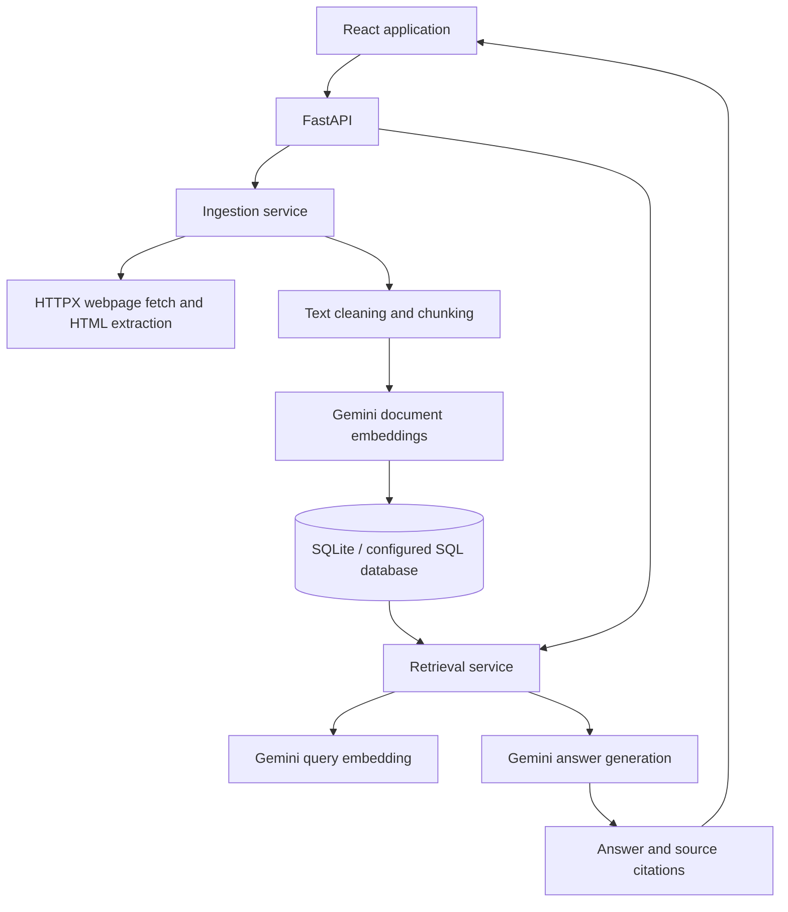

# AI Knowledge Inbox

AI Knowledge Inbox is a single-user knowledge workspace for saving text notes and importing public HTML webpages, then asking natural-language questions answered from semantically retrieved passages.

The backend stores original content, chunks, and embeddings. Questions are embedded and compared with stored chunk embeddings; selected passages are sent to Gemini to produce an answer with source references.

## Features

- Save text notes and import public HTTP(S) webpages.
- Extract readable webpage text and retain source metadata.
- Split content into overlapping chunks and generate embeddings.
- Browse, search, paginate, view, and delete saved knowledge items.
- Ask questions against saved content using semantic retrieval.
- Return answer text with source snippets and similarity scores.
- Light/dark theme support in the React interface.

## Technology stack

| Layer | Technology |
|---|---|
| Frontend | React 19, Vite, Axios, Lucide React |
| API | FastAPI, Pydantic, Uvicorn |
| Persistence | SQLAlchemy, SQLite by default |
| Embeddings | Gemini `gemini-embedding-001`, 768 dimensions |
| Answer generation | Gemini chat model; default `gemini-3.1-flash-lite` |
| Web extraction | HTTPX, BeautifulSoup, lxml |
| Tests | pytest |

## Repository layout

```text
.
├── BACKEND/
│   ├── app/
│   │   ├── core/config.py
│   │   ├── db/database.py
│   │   ├── llm/
│   │   │   ├── models.py
│   │   │   └── rag/
│   │   │       ├── chunking.py
│   │   │       ├── embeddings.py
│   │   │       ├── generation.py
│   │   │       ├── ingestion.py
│   │   │       └── retrieval.py
│   │   ├── routes/
│   │   │   ├── items.py
│   │   │   └── query.py
│   │   ├── schemas/
│   │   └── services/webpage.py
│   ├── tests/
│   ├── .env.example
│   └── requirements.txt
└── FRONTEND/
    ├── src/
    ├── .env.example
    └── package.json
```

## Local setup

### Requirements

- Python 3.11 or a compatible supported Python version.
- Node.js and npm.
- A Gemini API key.

### 1. Start the backend

Windows PowerShell:

```powershell
cd BACKEND
py -3.11 -m venv .venv
.\.venv\Scripts\Activate.ps1
python -m pip install --upgrade pip
pip install -r requirements.txt
Copy-Item .env.example .env
```

Edit `BACKEND/.env` and set `GEMINI_API_KEY`, then run:

```powershell
uvicorn app.main:app --reload
```

The API listens at `http://127.0.0.1:8000`. Interactive API documentation is at `http://127.0.0.1:8000/docs`.

### 2. Start the frontend

In a second terminal:

```powershell
cd FRONTEND
npm install
Copy-Item .env.example .env
npm run dev
```

Open the Vite URL shown in the terminal (normally `http://localhost:5173`). `VITE_API_BASE_URL` defaults to `http://127.0.0.1:8000`.

### 3. Run checks

```powershell
cd BACKEND
python -m pytest -q
```

```powershell
cd FRONTEND
npm run lint
npm run build
```

## API overview

| Method | Path | Purpose |
|---|---|---|
| `GET` | `/` | Basic service welcome/status response |
| `GET` | `/health` | Basic health response |
| `POST` | `/ingest` | Save a note or import a webpage |
| `GET` | `/items` | List, search, and paginate items |
| `GET` | `/items/{item_id}` | Read one item's raw content |
| `DELETE` | `/items/{item_id}` | Delete an item and its chunks |
| `POST` | `/query` | Retrieve relevant chunks and generate an answer |

See [API.md](API.md) for request and response contracts.

## Architecture at a glance



## Design choices and trade-offs

### Chunking

Content is split into 500-word chunks with an 80-word overlap. This is straightforward and preserves some context across boundaries, but can split sentences, tables, or headings.

### Vector storage and retrieval

Embeddings are stored as JSON in SQL rows. Retrieval loads all chunks and computes cosine similarity in Python. This keeps deployment simple but scales linearly with the number of chunks; there is no vector index.

### Database

SQLite is the default and is suitable for a small local or single-user installation. `DATABASE_URL` can point SQLAlchemy at another supported database, but production migration, schema management, and database-specific testing are not included here.

### Request lifecycle

Ingestion performs webpage fetching, embedding generation, and persistence before returning the response. It is not a background job. Chat history is held in frontend React state and is not persisted by the backend.

### Retrieval quality

The similarity threshold is currently `0.60`, and the default `top_k` is 5. These are initial settings, not guarantees of relevance; evaluate them with representative questions and documents.

## Current limitations

- No authentication, authorization, or per-user data separation.
- No persistent server-side chat history.
- No background ingestion queue or job-status API.
- No vector database or approximate-nearest-neighbor index.
- Webpage import is limited to HTML/XHTML and does not execute JavaScript.
- URL validation reduces SSRF risk, but DNS validation is not pinned to the eventual connection (see [SECURITY.md](SECURITY.md)).
- The health endpoint reports application status; it does not verify Gemini connectivity or database readiness.

## Suggested production work

Add authentication and per-user authorization, robust egress controls for URL imports, migrations, backups, observability, rate limits, provider quotas, retrieval evaluation, and background ingestion before exposing the service to untrusted users.
