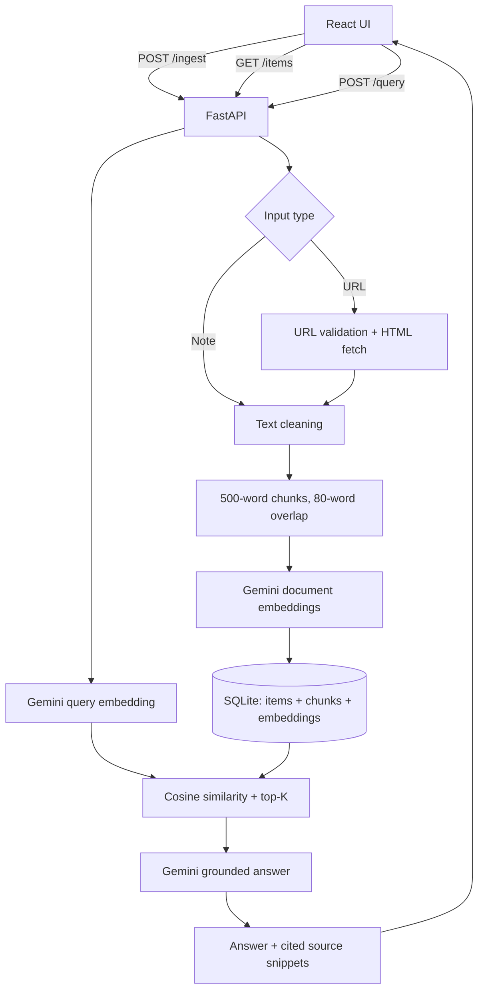

# AI Knowledge Inbox

A focused, single-user knowledge workspace: save text notes or import webpages, then ask natural-language questions and receive answers grounded in retrieved passages with source citations.

## Stack

- **API:** FastAPI, Pydantic, SQLAlchemy
- **Storage:** SQLite for item metadata, raw text, chunks and JSON-serialized embeddings
- **AI:** Gemini Embeddings (`gemini-embedding-001`) and Gemini chat generation
- **Retrieval:** cosine similarity in Python, top-K ranking with a configurable starting threshold
- **UI:** React 19 + Vite, Axios and Lucide icons; persistent light/dark themes

## Features

- Ingest text notes and public HTML webpages (fetched server-side).
- Preserve the raw extracted content and source metadata.
- Split content into overlapping chunks and create document embeddings.
- Search all saved items with server-side pagination.
- Retrieve semantically relevant chunks and generate a context-grounded answer.
- Display source snippets and similarity scores beside answers.
- Delete an item and its associated chunks.
- Retry a failed question and switch between warm light and dark themes.

## Run locally (Windows PowerShell)

### 1. Backend

```powershell
cd BACKEND
py -3.11 -m venv .venv
.\.venv\Scripts\Activate.ps1
python -m pip install --upgrade pip
pip install -r requirements.txt
Copy-Item .env.example .env
# Edit .env and set GEMINI_API_KEY
uvicorn app.main:app --reload
```

API: `http://127.0.0.1:8000` · Swagger: `http://127.0.0.1:8000/docs`

### 2. Frontend (new terminal)

```powershell
cd FRONTEND
npm install
Copy-Item .env.example .env
npm run dev
```

Open `http://localhost:5173`. Set `VITE_API_BASE_URL` in `FRONTEND/.env` only if the API is hosted somewhere other than `http://127.0.0.1:8000`.

### 3. Tests and build

```powershell
# Backend
cd BACKEND
python -m pytest -q

# Frontend
cd ..\FRONTEND
npm run lint
npm run build
```

## Architecture



## Core workflow

### Ingestion

1. The API validates the request shape and whether it is a note or URL.
2. For a URL, the backend validates the scheme/host, checks DNS answers against non-public IP ranges, refuses redirects, checks the HTML content type and enforces a 2 MiB response limit.
3. The readable text is cleaned and split into chunks.
4. Gemini creates one embedding per chunk using the document retrieval task type.
5. The raw item and its chunks/embeddings are committed together to SQLite.

### Question answering

1. The question is embedded using Gemini's query retrieval task type.
2. The backend loads stored chunks, calculates cosine similarity and selects up to `top_k` chunks above the initial `0.60` similarity threshold.
3. The selected passages and question are sent to Gemini with instructions to use only the retrieved context and treat source text as untrusted data.
4. The API returns the answer plus source metadata, snippets and similarity scores. If no chunks pass the threshold, it returns an explicit no-context response rather than asking the model to guess.

## Design choices and tradeoffs

### Chunking: 500 words with 80-word overlap

A moderate chunk gives the model enough local context without routinely sending an entire document. The overlap reduces the chance that a fact split at a chunk boundary becomes difficult to retrieve. Word-based chunking is simple and predictable, but it can split sentences, headings or tables. A production pipeline could use structure-aware splitting and tune chunk size using a representative evaluation set.

### SQLite + JSON embeddings + Python cosine similarity

This keeps the assessment easy to run and avoids provisioning a separate vector database. It is appropriate for a small, single-user knowledge base. Its cost is that embeddings are not indexed: every query loads and scores all chunks, so latency and memory use grow linearly with corpus size. SQLite JSON storage is not a vector index.

### Gemini models

The application uses Gemini for both embedding and generation to keep the integration small. Document and query embeddings use their respective retrieval task types. A low generation temperature encourages consistent, source-grounded answers; the prompt also explicitly prohibits unsupported claims.

### Async behavior

URL fetching and Gemini calls use asynchronous I/O. Synchronous SQLAlchemy operations that occur inside async ingestion/retrieval paths are offloaded to a worker thread so they do not directly block the event loop. Ingestion still runs within the request lifecycle: the client waits for fetch, embedding and persistence to finish. Chat history remains in browser React state and is cleared on refresh. For larger workloads, move ingestion to a background worker and persist job status; use async SQLAlchemy consistently or keep database-heavy routes synchronous.

## Security notes and limitations

- URL import accepts only HTTP(S), rejects credentials and localhost, checks resolved IPs for non-public addresses, disables redirects, ignores environment proxy configuration, applies a timeout and caps downloaded bytes.
- **DNS rebinding limitation:** hostname validation and HTTPX's connection-time DNS resolution are separate operations. This reduces common SSRF risk but does not cryptographically/persistently bind the connection to the validated IP. For production use with untrusted users, route outbound fetches through a trusted egress proxy or implement a transport that pins the validated destination while preserving TLS hostname verification.
- The service has no authentication or per-user isolation; it is intentionally a single-user assessment app. Do not expose it publicly with private data without adding authentication, authorization and rate limiting.
- The application has no persistent chat history. The browser's chat messages are transient.
- Gemini API keys must remain in backend environment variables and must never be placed in frontend variables or committed.
- The `0.60` retrieval threshold is a starting heuristic, not a universal relevance guarantee. Evaluate it against labelled queries and monitor false positives/negatives.

## API reference

### `POST /ingest` — create a note

Request:

```json
{
  "source_type": "note",
  "title": "Vector search notes",
  "content": "Embeddings represent text as numeric vectors..."
}
```

Success (`201`):

```json
{
  "id": 12,
  "title": "Vector search notes",
  "source_type": "note",
  "source_url": null,
  "chunk_count": 1,
  "message": "Content successfully saved and indexed"
}
```

For a webpage, send `{"source_type":"url","url":"https://example.com/article"}`. `title` is optional for both types.

### `GET /items?skip=0&limit=20&search=vector`

Returns `{ "total": 1, "items": [...] }`. `total` is the count after applying the optional search. `skip` and `limit` support pagination; `search` matches title and raw content.

### `DELETE /items/{item_id}`

Deletes the saved item and its associated chunks. Returns `204 No Content`, or `404` if the item does not exist.

### `POST /query`

Request:

```json
{ "question": "What do my notes say about vector search?", "top_k": 5 }
```

Success (`200`) returns `question`, `answer`, `retrieved_count`, and `sources`. Each source includes its item/chunk IDs, title, source type, snippet and similarity score. Citations in answer text use `[S1]`, `[S2]` in the same order as the `sources` array.

### Error behavior

- `422`: invalid input, unsupported URL, unreadable webpage or failed content extraction.
- `413`: extracted webpage content exceeds the configured chunk limit.
- `404`: item does not exist.
- `503`: embedding or answer-generation provider unavailable.
- `500`: unexpected persistence failure.

## What I would change before production

1. Add authentication, authorization, per-user data ownership and request rate limits.
2. Use a trusted outbound-fetch proxy or destination-pinned HTTP transport to close the DNS rebinding gap; add a strict allow/deny policy and egress monitoring.
3. Move to PostgreSQL with pgvector or a managed vector database when corpus size and concurrent users justify it.
4. Add background ingestion jobs, retries, idempotency and job-status endpoints for slow URL/embedding operations.
5. Add durable conversation storage if chat history is a product requirement.
6. Add observability (structured JSON logs, metrics, traces), provider quotas and cost controls.
7. Add richer evaluation data for retrieval quality, prompt-injection tests and API contract tests in CI.
8. Consider content deduplication, re-indexing/versioning, deletion audit events and backups.

## Repository hygiene

The SQLite database, `.env`, virtual environments, build output, `node_modules`, Python caches and Git metadata are intentionally excluded from the submission archive. Copy `.env.example` to `.env` and supply your own key locally.
